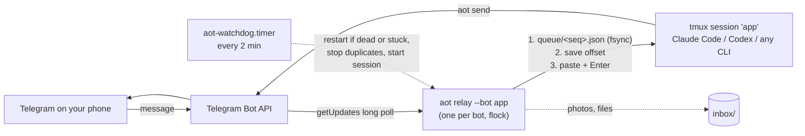

<h1 align="center">agent-ops-telegram</h1>

<p align="center">
  <b>Run a coding agent 24/7 in tmux on a server and talk to it from your phone through a Telegram bot, without losing messages.</b><br>
  Works with Claude Code, Codex CLI or any terminal program. One small Python CLI (<code>aot</code>) using only the standard library (plus <code>tomli</code> on Python 3.10).
</p>

<p align="center">
  <a href="https://github.com/vladosskins178/agent-ops-telegram/actions/workflows/ci.yml"></a>
  <a href="https://github.com/vladosskins178/agent-ops-telegram/blob/main/LICENSE"></a>
  
  
</p>

---

The idea is simple: your agent runs in a tmux session on a VPS, a relay types your
Telegram messages into that session, and the agent answers with `aot send`. You can
still `tmux attach` from a laptop and see the very same conversation.

The simple version breaks in boring ways, and each of these happened to us more than
once while running agents this way for months:

- **Two pollers on one bot token.** A restarted script left an old copy running, and
  Telegram handed each message to one of them at random. Half the messages vanished.
- **The relay was alive but stuck.** `Restart=always` only helps when the process dies.
- **The server rebooted.** The relay came back, the agent's tmux session did not, and
  messages were "delivered" into nothing.
- **The agent showed a confirmation dialog.** The pasted message answered the dialog,
  or the Enter key was swallowed and the text sat in the input line.
- **`$5` became an empty string** because a reply went through `"double quotes"` in bash.

`aot` is that relay with those lessons built in.

| Command | What it does |
| --- | --- |
| `aot init` | Asks for the bot token, finds your chat id when you message the bot, writes a private config, a `600` secrets file and systemd units. |
| `aot relay --bot NAME` | Long-polls Telegram, writes every allowed message to an on-disk queue, then types it into the agent's tmux pane. One process per bot, enforced with a lock. |
| `aot send` | Sends text (split at 4096), photos, albums and files from the agent. Retries with backoff, prints `sent` only on `ok: true`. Plain text by default. |
| `aot doctor` | Token valid, webhook not set, exactly one poller, no recent 409 Conflict, relay heartbeat fresh, service and watchdog active, tmux session present, no dialog blocking input, queue age, disk space. Every failure has a fix. |
| `aot watchdog` | Run by a systemd timer every 2 minutes: restarts a dead or stuck relay, stops duplicate pollers, starts the agent session after a reboot, and tells you on Telegram what it did. |
| `aot status`, `aot logs` | One line per bot; the relay log with tokens redacted. |
| `aot instructions`, `aot skill` | The block to append to `CLAUDE.md` / `AGENTS.md`, and an agent skill (also a Claude Code plugin) that teaches the agent the prompt format and how to reply. |

## Quick start

**1. Create a bot.** In Telegram, open [@BotFather](https://t.me/BotFather), send
`/newbot`, pick a name, and copy the token (`123456789:AA...`).

**2. Install on the server** (Python 3.10+ and tmux):

```bash
sudo apt install tmux pipx            # or: brew install tmux pipx
pipx ensurepath                       # puts ~/.local/bin on your PATH (open a new shell after)
pipx install "git+https://github.com/vladosskins178/agent-ops-telegram"
```

**3. Set it up.** `aot init` asks a few questions. When it says so, send any message to
your bot from your phone, so it can read your chat id. It lists every chat that wrote
during the wait with its id and name; if more than one did (or a group), nothing is
preselected, so a stranger who messages the bot at the same moment is never allowed by
pressing Enter:

```text
$ aot init
Bot name (short id used for the service and tmux session) [agent]: app
Create a bot with @BotFather (/newbot) and paste its token. Input is hidden.
Bot token:
Token OK: @my_agent_bot
Now open Telegram and send any message to @my_agent_bot. Waiting up to 120 s...
1 chat(s) wrote to @my_agent_bot:
  - private chat 123456789 @you, sent by user 123456789 (you)
Allow private chat 123456789 @you to send prompts to the agent? (y/n) [y]:
tmux session the agent runs in [app]:
Command that starts the agent if the session is missing (empty: never start it) [claude --continue || claude]:
Working directory for the agent [/home/you/project]:
Run the services as system units (/etc/systemd/system) or user units, or none? (system/user/none) [user]:
Wrote /home/you/.config/agent-ops-telegram/config.toml (mode 600)
Stored the token in /home/you/.config/agent-ops-telegram/secrets.env as AOT_TOKEN_APP (mode 600)
Wrote /home/you/.config/systemd/user/aot-relay@.service, /home/you/.config/systemd/user/aot-watchdog.service, /home/you/.config/systemd/user/aot-watchdog.timer

Next steps:
1. Tell the agent how to answer (before it starts, so it reads it; restart an agent that is already running):
   aot instructions --bot app >> /home/you/project/CLAUDE.md   (or AGENTS.md)
2. Start the relay and the watchdog:
   systemctl --user daemon-reload
   systemctl --user enable --now aot-relay@app.service aot-watchdog.timer
   loginctl enable-linger $USER   # keep user services running after you log out
3. The agent session 'app' is started on the first message (or by the watchdog within 2 minutes).
4. Check everything: aot doctor --bot app, then message the bot from your phone.
```

**4. Tell the agent how to answer.** Do this before the agent starts, so it reads it:

```bash
aot instructions --bot app >> ~/project/CLAUDE.md      # or AGENTS.md for Codex and others
```

**5. Start the services** (the commands `aot init` printed):

```bash
systemctl --user daemon-reload
systemctl --user enable --now aot-relay@app.service aot-watchdog.timer
loginctl enable-linger $USER        # keep user services running after you log out
```

With `start_command` set, you do not start the agent yourself: the watchdog starts the
tmux session within about two minutes (or the relay does on the first message). Look at
it any time with `tmux attach -t app`. Without `start_command`, start it yourself:
`tmux new -s app 'claude'`.

System units (`/etc/systemd/system`, commands without `--user`) are the other choice;
`aot init` asks. Run the relay as the same user that owns the agent's tmux session:
tmux sessions are per user. Avoid `sudo aot init` unless the agent really runs as root.

**6. Check it:** run `aot doctor`, then send "hi" from your phone. The message gets an
eyes reaction once it has been typed into the session, and the agent answers with
`aot send`.

Non-interactive setup, for provisioning scripts:

```bash
printf '%s\n' "$TOKEN" | aot init --yes --token-stdin --name app --chat 123456789 \
  --tmux app --start-command 'claude --continue' --workdir ~/project
```

## How it works



**Inbound.** The relay long-polls `getUpdates` and drops anything that is not from an
allow-listed chat (and, optionally, user). For each allowed message it first writes the
raw update to `queue/<seq>.json` with `fsync`, then saves the next offset (together with
the bot's id, so a changed token is noticed even without `health.json`), and only then
tries to deliver. A crash at any point either re-fetches the update or finds it in the
queue, so nothing is lost across restarts. `<seq>` is a persisted, strictly increasing
number that sets the delivery order: neither the clock (NTP may step it back) nor
Telegram's update ids (restarted after a week without updates) can reorder or merge
messages. Photos (largest size), documents, voice,
audio and video are downloaded to an `inbox/` directory (mode 700 when aot creates it,
names sanitised, `<timestamp>-<chat>-<msg>-<hex6>-<name>`, never overwritten) and passed
as `file=/path`. A prompt looks like this:

```text
[TG @you chat_id=123456789 msg_id=42 file=/home/you/.local/state/agent-ops-telegram/app/inbox/20261104-101500-123456789-42-a1b2c3-photo.jpg]: what is wrong on this screen?
```

**Typing into the agent.** The text goes through `tmux load-buffer` from stdin and
`paste-buffer -p` (bracketed paste). No shell is involved, so `$`, quotes and backticks
arrive exactly as typed. Control characters (including ESC, which could end a bracketed
paste or send key sequences) are stripped. Long texts are pasted in chunks; very long
ones are saved to a file and the prompt points at it. After Enter, the relay looks at
the bottom of the pane and presses Enter again if the text is still sitting in the input
line (a busy agent sometimes swallows it). If someone left the pane in tmux copy mode
(scrolled back from a laptop), the relay leaves copy mode first, because copy mode would
swallow every key. Session names are matched exactly (`-t =app`), because plain
`-t app` also matches a session called `app2`.

**When the agent cannot take input.** If the tmux session is missing, the relay starts
it with `start_command` (when set) and tells you your message is queued. If the bottom
of the pane shows a confirmation prompt ("Do you want to proceed?", "Do you trust the
files in this folder?", `(y/n)`...), pasting would answer it, so the message stays
queued and you get the last lines of the
screen on Telegram. Answer with `/aot keys 1` (or `Enter`, `Escape`, `y`...), or send
`/aot flush` to paste anyway. Messages are always delivered in order.

**Delivery guarantee.** At least once: a message leaves the queue only after it was
pasted and submitted. If the relay is killed in the moment between those two steps,
that one message can be typed twice after the restart. If tmux fails before anything
was typed, the message stays queued and is retried. If it fails halfway through a
chunked paste, the relay does not retry (that would type the start twice); it tells you
the message may be incomplete.

**Single poller.** Each relay holds two exclusive `flock`s for its whole lifetime: one
on `state_dir/locks/bot-<hash>.lock`, named after a hash of its token (two configs for
the same bot share it), and one on `state_dir/<bot>/relay.lock`, its bot's state
directory (so two relays for the same bot name never share one offset and queue, even
with different tokens). A relay that cannot take either lock refuses to start: it logs
which other relay holds it, waits about 30 seconds (to keep systemd's restart loop slow)
and exits with code 3. The kernel drops the locks when a relay dies, so a crash never
leaves a stale lock. Telegram's own
`409 Conflict` (another poller elsewhere, or a webhook) is recorded, reported to you
once, and shown by `aot doctor`. The watchdog stops extra `aot relay` processes for the
same bot and keeps the one that holds the lock. A relay that just lost the race for the
lock (it holds neither lock and is waiting to exit with code 3) is left alone; only a
process that holds a lock it should not, or has run for more than 90 seconds without
one, is stopped.

**Health.** Every poll writes a heartbeat to `health.json` (wall-clock time plus a
monotonic reading and the boot id, so a clock step is never mistaken for a stuck relay). `aot doctor` and the
watchdog treat a running relay without a fresh heartbeat as stuck, which is the case
`Restart=always` cannot catch. The watchdog restarts the relay with `systemctl`; where it
is not allowed to (system units running as a normal user), it stops the stuck process
and lets `Restart=always` bring it back. It also restarts an enabled relay that you
stopped by hand, so use `systemctl disable --now` to really stop one.

## Sending from the agent

```bash
aot send 'Tests pass. Deployed to staging.'
aot send - <<'EOF'
The plan costs $5/month; run `make deploy` when ready.
EOF
aot send --photo before.png --photo after.png 'Menu, before and after'
aot send --document report.pdf
git diff --stat | aot send -
```

- **Quote with single quotes or a quoted heredoc.** In `aot send "costs $5"` bash
  replaces `$5` with an empty string before `aot` runs. No program can undo that, so
  the skill and `aot instructions` teach the agent to use `'...'` or `<<'EOF'`.
- Plain text is the default, so a stray `_` or `*` never breaks a message.
  `--markdown` and `--html` exist; a part Telegram cannot parse is re-sent as plain text.
- Text over 4096 characters (counted in UTF-16 units, as Telegram counts them) is split
  at paragraph, line or word boundaries. Captions over 1024 go as a separate message.
- 2 to 10 photos or documents become an album; more become several albums. A file that
  is not a photo Telegram accepts is sent as a document.
- Network errors, 5xx and 429 are retried with exponential backoff (429 waits for
  `retry_after`). Exit code `0` and `sent` only when every part came back `ok: true`,
  `1` when something was not delivered, `2` for usage errors. `--json` prints the
  message ids.
- `aot send` only sends to allow-listed chats. `--chat` picks one; the default is
  `default_chat`.
- A retry after a timeout can deliver a message twice if Telegram had in fact received
  the first attempt; the Bot API has no way to deduplicate sends.
- With `--photo` or `--document`, the text arguments are the caption. To pipe a caption
  in, pass `-`: `git log -1 | aot send --photo shot.png -`.

## Commands from the phone

Text messages starting with `/aot` are handled by the relay and never reach the agent. A
caption on a photo or file is always typed in as text, even when it starts with `/aot`, and
so are forwarded messages: only a plain text message you send can run a command. Commands
run in the order they were sent, so messages sent before a command are typed in first:

| Command | Effect |
| --- | --- |
| `/aot status` | Relay uptime, queue length, whether the session runs and whether a prompt is open. |
| `/aot screen [N]` | The last N lines (default 30, max 80) of the agent's terminal, tokens redacted. |
| `/aot keys KEY...` | Press keys: `Enter`, `Escape`, `Tab`, arrows, `C-c`, `y`, `n`, `0`-`9`... Only these names; text always goes through the paste path. |
| `/aot queue`, `/aot flush`, `/aot drop` | List queued messages, paste them even though a prompt is open, or delete them. |
| `/aot start` | Start the agent session with `start_command`. |

Turn them off with `remote_commands = false`, or change the prefix with `command_prefix`.

## Several projects on one server

One bot per project, one relay per bot, one tmux session per agent. Run `aot init`
again with another name: it appends a `[bots.<name>]` table and a token line, and the
same `aot-relay@.service` template runs every instance.

```toml
[defaults]
env_file = "~/.config/agent-ops-telegram/secrets.env"
state_dir = "~/.local/state/agent-ops-telegram"
systemd = "user"

[bots.game]
token_env = "AOT_TOKEN_GAME"
allowed_chats = [123456789]
tmux_target = "game"
start_command = "claude --continue || claude"
workdir = "~/game"

[bots.site]
token_env = "AOT_TOKEN_SITE"
allowed_chats = [123456789, -1001234567890]   # you, and a group
allowed_users = [123456789]                   # in the group, only you
tmux_target = "site"
start_command = "codex"
workdir = "~/site"
```

```bash
systemctl --user enable --now aot-relay@game.service aot-relay@site.service aot-watchdog.timer
```

Sessions started by the relay or the watchdog get `AOT_BOT` and `AOT_CONFIG` in their
environment, so `aot send` inside them picks the right bot without `--bot`. Every
setting is described in [docs/config.md](https://github.com/vladosskins178/agent-ops-telegram/blob/main/docs/config.md).

If the agent exits, its tmux session closes with it. To keep the session alive, wrap
the command in a loop, for example
`start_command = "while true; do claude --continue || claude; sleep 5; done"`
(`claude --continue` alone exits in a folder with no earlier conversation).

A session started by the relay or the watchdog runs with the service's environment:
the `PATH` that `aot init` / `aot units` wrote into the unit (your `PATH` at that time
plus `~/.local/bin`), your `HOME`, and no `sudo` restrictions. The units use
`KillMode=process`, so restarting the relay never kills the agent's tmux server. If you
install the agent CLI somewhere new later, run `aot units --write` again (then
`daemon-reload`) to refresh the `PATH`.

## Troubleshooting

`aot doctor` checks all of these; the table is the short version.

| Symptom | Likely cause | What to do |
| --- | --- | --- |
| Some messages never arrive, at random | Two programs poll the same bot token; Telegram gives each update to one of them | `aot doctor` (`poller.single`, `poller.conflict`). Stop the other poller: an old script, another server, a framework using the same token. |
| Nothing arrives, the log shows `409 Conflict` | A webhook is set for the bot | `aot doctor --fix` deletes it (only if nothing else needs it). |
| Nothing arrives, relay "running" | Relay stuck (network or tmux hang) | `aot doctor` shows a stale heartbeat; the watchdog restarts it within about 2 minutes. Is `aot-watchdog.timer` enabled? |
| You get "session was not running" | Server rebooted or the agent exited | Set `start_command` (and a loop, see above). The watchdog also starts it after boot. |
| The session the relay starts closes at once | `start_command` failed, often "command not found" because the agent CLI is not on the unit's `PATH` | Run the command by hand in `tmux new -s test`; use an absolute path in `start_command`, or re-run `aot units --write` so the unit gets your current `PATH`. |
| `aot relay` exits with code 78 and is not restarted | The config cannot be loaded, the bot token is missing (`AOT_TOKEN_<BOT>` not in the env file), or Telegram rejected the token (401 Unauthorized, or 404 for a malformed token) | Fix what the journal line says, then `systemctl restart aot-relay@<bot>.service` (with `--user` for user units). systemd does not retry this exit code, so a missing token does not fill the journal. |
| `aot relay` exits with code 3 | Another relay already holds the token lock (`state_dir/locks/bot-<hash>.lock`) or the bot's state lock (`state_dir/<bot>/relay.lock`, e.g. a second relay for the same bot name with another token) | Expected while a duplicate exists; the log line names the other relay's pid, and `aot status` / `aot doctor` show which one runs. The relay waits about 30 s before exiting, systemd retries, and it takes over once the other one stops. |
| Messages wait and you get the screen with a prompt | The agent is asking for confirmation | `/aot keys 1` (or `y`, `Enter`, `Escape`), or `/aot flush` to paste anyway. |
| Text appears in the agent's input but is not sent | Enter swallowed while the agent was busy | The relay retries Enter (`submit_retries`). Raise it, or send `/aot keys Enter`. |
| The agent answers in the terminal, not on Telegram | It forgot to use `aot send` (often deep into a long conversation) | Put `aot instructions` in `CLAUDE.md` / `AGENTS.md`, install the skill, start a fresh conversation. |
| `$5` or `` `cmd` `` missing from replies | Bash expanded them inside double quotes | Use single quotes or `aot send - <<'EOF'`. |
| `aot` refuses the config | It is readable by other users | `chmod 600` it: the allow-list decides who can type into your agent. |
| Telegram rejects the token (401) | Token revoked or regenerated in @BotFather | Put the new token in the secrets file and restart the relay. The relay exits with code 78, at startup or while running; neither systemd nor `aot watchdog` restarts it, and the watchdog sends one alert. |
| The queue stops, disk full | Inbox or logs filled the disk | `aot doctor` (`disk.free`, `disk.inbox`); delete old inbox files. |

## Security

- **Only allow-listed chats (and optionally users) reach the agent.** Everything else
  is dropped without an answer and logged without its content. In groups, set
  `allowed_users` too, or anyone in the group can type into your agent.
- **Messages become prompts: treat that as remote command execution.** An agent with
  shell access does what the prompt says, so whoever controls an allow-listed Telegram
  account controls your server. Protect that account with two-step verification, keep
  the allow-list short, and run the agent as an unprivileged user. Forwarded messages,
  downloaded files and web pages can carry instructions too (prompt injection). The
  relay marks forwarded text with `[forwarded]` and prefixes each of its lines with
  `| `, so it cannot pass for a prompt header of its own (messages sent through an inline
  bot get `[via inline bot]`), and the skill tells the agent to treat such content as
  data, but no marker makes an agent immune. A forwarded `/aot ...` command is never run:
  it is typed in as forwarded text.
- **Secrets.** The token lives in an env file (mode 600) or the environment, never in
  the config. `aot` refuses a config or secrets file that anyone but you can read. Tokens are redacted from logs, error messages,
  `/aot screen` output and doctor reports, and `aot init` reads the token without echo.
- State (queue, inbox, logs) is created with mode 600/700. Downloads are capped at
  `max_download_mb` and saved under sanitised names inside the inbox only.

See [SECURITY.md](https://github.com/vladosskins178/agent-ops-telegram/blob/main/SECURITY.md) for how to report a vulnerability.

## How it compares

Good projects in this space take a different approach. Pick the one that matches how
you want to work:

- **Claude Code channels** (official, research preview): the
  [Telegram channel plugin](https://code.claude.com/docs/en/channels)
  (`telegram@claude-plugins-official`, started with `claude --channels ...`) pushes
  Telegram messages into a running Claude Code session through an MCP server, with
  pairing and a sender allowlist, and Claude replies through a tool. It is the most
  integrated option for Claude Code. It needs Bun and a claude.ai or Console sign-in
  (Team and Enterprise admins must enable it), works only with Claude Code, and
  messages arrive only while that session is open. Anthropic's
  [Remote Control](https://code.claude.com/docs/en/remote-control) instead lets you drive
  a local session from the Claude app.
- [cc-connect](https://github.com/chenhg5/cc-connect) (Go) connects many agents (Claude
  Code, Codex, Gemini CLI, Cursor and more) to many chat platforms (Telegram, Slack,
  Discord, Feishu, DingTalk, LINE...), runs the agent as a subprocess and manages chat
  sessions. Choose it if you want one bridge for many platforms or a chat-first
  session model.
- [claude-code-telegram](https://github.com/RichardAtCT/claude-code-telegram) (Python)
  is a full Telegram bot built on the Claude Agent SDK, with per-project sessions,
  directory sandboxing, rate limits, cost tracking, Git helpers and a SQLite store.
  Choose it for a rich, Claude-specific bot.
- **agent-ops-telegram** does not run or wrap the agent. It types into the interactive
  session you already use in tmux, so any terminal agent works unchanged and you can
  attach from a laptop to continue the same conversation. It runs as its own service,
  so messages that arrive while the agent is down or busy wait in a queue on disk.
  Its focus is operations: not losing messages, one poller per token, a watchdog, and a
  doctor for the failure modes above. It is Telegram-only and has no session management
  of its own.

## Use it from an agent

`aot instructions --bot NAME >> CLAUDE.md` (or `AGENTS.md`) is all an agent strictly
needs. The skill says the same in more depth: how prompts look, how to quote replies,
sending screenshots, and what to check when the relay misbehaves.

**Claude Code** (plugin with the skill):

```text
/plugin marketplace add vladosskins178/agent-ops-telegram
/plugin install agent-ops-telegram@agent-ops-telegram
```

Or copy only the skill: `aot skill install` writes
`~/.claude/skills/agent-ops-telegram/SKILL.md` (`--dir` for another skills folder).

**Codex, Gemini CLI, Aider and others:** append it to the project's `AGENTS.md` or rules
file with `aot skill print >> AGENTS.md`.

## Requirements and limits

- Linux (systemd optional) or macOS, Python 3.10+, tmux 3.0+. `aot send` alone needs
  neither tmux nor systemd. Duplicate-process detection reads `/proc` and is Linux-only;
  the lock works everywhere.
- Telegram limits: bots can download files up to 20 MB and upload up to 50 MB.
- "Text still in the input line" and the confirmation-dialog patterns are heuristics
  that read the bottom of the pane. The defaults were written against Claude Code's
  prompts and common `(y/n)` styles; check them against your tool and adjust
  `blocked_patterns` and `submit_check_lines` if needed.
- Voice messages arrive as audio files (`file=...ogg`); transcription is up to the
  agent or your own tooling.
- Edited messages are not re-sent to the agent.
- If the agent's own output near the bottom of the screen contains a phrase that looks
  like a confirmation prompt (for example it repeats your "(y/n)" question), the relay
  treats it as a dialog and holds the queue. That errs on the safe side; `/aot screen`
  shows what it saw and `/aot flush` sends anyway.

## Contributing

Issues and pull requests are welcome; see [CONTRIBUTING.md](https://github.com/vladosskins178/agent-ops-telegram/blob/main/CONTRIBUTING.md).

## License

[MIT](https://github.com/vladosskins178/agent-ops-telegram/blob/main/LICENSE)
